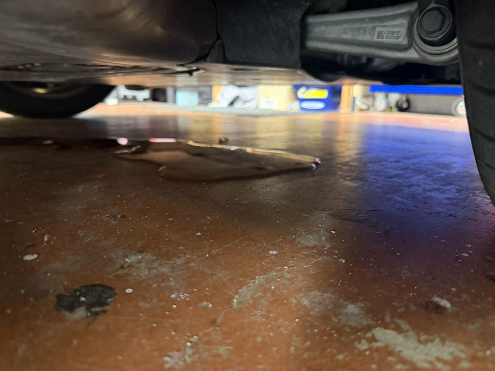
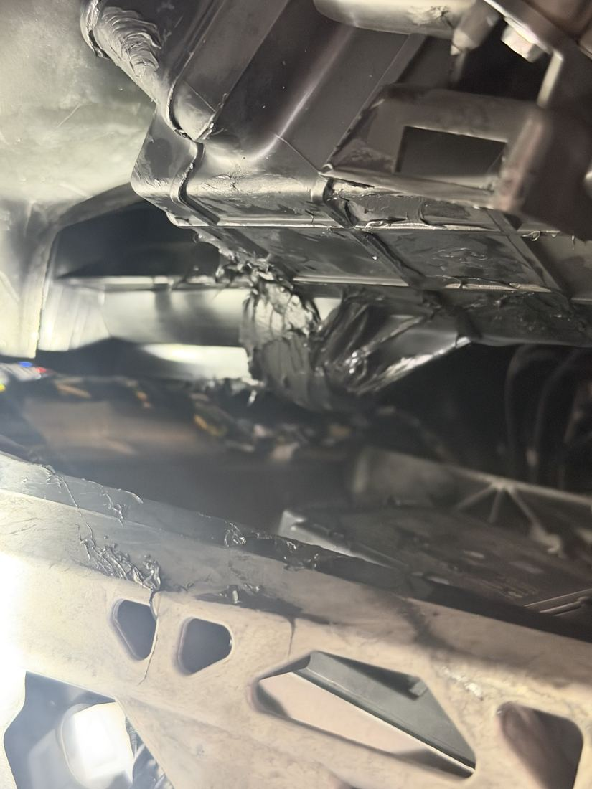
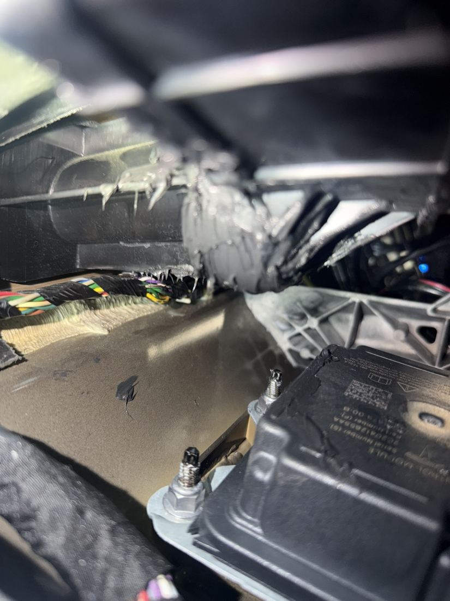

# 2021+ Model S AC Drain Leak: DIY Repair Guide

A printable guide for fixing wet front footwells on a 2021+ Tesla Model S caused by a leaking AC drain funnel seal. Open `index.html` in a browser for the illustrated, printable version with tickable checklists.

Tesla's fix is Service Bulletin SB-26-18-001, "Rework HVAC Drain Funnel Seal" (February 4, 2026), for 2021+ Model S and Model X. It reseals the drain funnel's foam sponge through the two front footwells, with the seats and dash left in place. Tesla's labor time for a Model S is 0.48 hours.

> **Result: the fix held.** On this 2021 Model S, the AC test before sealing showed water coming into the cabin. After resealing the drain funnel with Permatex Ultra Black and letting it cure, a 30-minute test with the AC on max left the cabin completely dry, with the condensation draining under the car as it should. Tested November 28, 2026.

## Before you pull anything: confirm the cause

Two wet front footwells after heavy rain can be a rain leak or the AC drain gasket. Sealing the gasket only fixes the second, so run these checks first.

| Check | Points to the AC gasket | Points to a rain leak |
| --- | --- | --- |
| Where the carpet is wettest | Inboard edge, next to the center console | Up high at the firewall, or the outer edge by the door |
| Dry-day test: dry the carpet, run the AC 20 minutes | Carpet gets wet again | Carpet stays dry |
| Cowl test: pour water into each corner at the base of the windshield | Water runs out fast behind the front wheels | Water pools, drains slowly, or shows up inside |

- [ ] Clear leaves and debris from the cowl (base of the windshield, under the frunk trim)
- [ ] Run the three checks and write down what you found

## Tools and materials

- [ ] Loctite 5900 Gen 3 flange sealant: Tesla part 1589861-00-A for North America. Tesla lists Würth Super RTV Silicone 200 ml (1949294-00-A) for other regions.
- [ ] Non-marring plastic scraper set. Tesla's is 1076972-00-A; plastic trim tools work.
- [ ] Flashlight
- [ ] 10 mm socket and a small ratchet: passenger footrest panel, 2 bolts and 1 nut, 5 Nm (3.7 lb-ft)
- [ ] Plastic trim tool for the clips on the console side carpets and A-pillar trims
- [ ] Optional, for the clog check: shop vac, a narrow adapter, clear tubing, jack stands or ramps
- [ ] Towels, OdoBan disinfectant concentrate (eucalyptus) and a spray bottle, a wet vac, a fan and a dehumidifier

**From the Bob's Garage follow-up video**

- [ ] Backup: E12 external Torx (E-Torx) socket. Bob's Garage calls it a special socket for this job, likely for the bracket that cuts your hand. Tesla's procedures list only a 10 mm socket, plus a 13 mm for the toeboard bracket's upper bolt; keep the E12 in case a bolt has an E-Torx head.
- [ ] Optional: Second Skin rope tape, a sticky black sealing tape he wrapped around the joint after a 24-hour cure
- [ ] Optional: a battery water-leak detector (about $10) and 3M VHB double-sided tape to stick it under the leak point
- [ ] Optional: 2 grout sponges set under the funnel to catch drips before they reach the carpet

**Sealant and cure time**

Both are moisture-cured silicone sealants and seal the same once cured. The difference is how long to wait before running the AC.

| Sealant | Skins over | Full cure | Wait before running the AC |
| --- | --- | --- | --- |
| Loctite 5900 Gen 3 (Tesla's spec) | 15 minutes | Days, deep in the gap | At least 1 hour (bulletin) |
| Permatex Ultra Black 82180 | 1 to 2 hours | 24 hours | 24 hours |

Allow more time in cold or dry weather. Sources: [Henkel product page](https://henkel-adhesives.com/ph/en/product/gasketing-sealants/loctite_si_5900.html), [Permatex product page](https://www.permatex.com/products/gasketing/black-gasket-makers/permatex-ultra-black-rtv-silicone-gasket-maker-13-oz/).

## Step 1: Rule out a clogged drain

A clog and a leaking gasket look the same from inside the car, so clear the drain before sealing anything. This step follows the owner's video.

1. Raise the front of the car safely and find the AC drain hose where it comes through the firewall. In the video it was resting on the front lower control arm.
2. Pull the small cap off the end of the hose.
3. Push the clear tubing into the hose, connect it to the shop vac, and run the vac for a few minutes. Water droplets in the tubing are normal.
4. Refit the cap and leave the hose pointing down so it drains freely.

Do not pull hard on the hose. Tesla's manual says replacing it means removing the high-voltage battery.

## Step 2: Get access

Tesla's bulletin reaches the gasket through two openings: the driver-side console carpet and the passenger footrest panel. The seats stay in.

**Driver side** (Tesla procedure 15196802)

1. Open the driver door, lower the window, and remove the floor mat.
2. Release the 11 clips holding the left center console side carpet, and lift it off.

**Passenger side** (Tesla procedure 15300012)

1. Open the passenger door, lower the window, move the seat fully rearward, and remove the floor mat.
2. Remove the passenger footwell cover, then the middle and lower A-pillar trims on that side.
3. Fold the front carpet aside and remove the right center console side carpet (11 clips).
4. Release the clip holding the wiring harness to the footrest panel.
5. Remove the 2 bolts and 1 nut with a 10 mm socket, and lift out the footrest panel. A control module sits behind it; keep sealant and water off it.

Removing the seats is optional. The video's owner pulled both front seats for working room. If you do, follow Tesla's seat page (linked below): power the car down first, never unplug a seat with the low-voltage battery connected (airbags), and plan on 8 new seat track bolts at 34 Nm, since Tesla discards the old ones.

## Step 3: Seal the gasket

Tesla's fix fills the gap between the foam sponge and the drain funnel with sealant, all the way around, from inside the gap.

Before you start, wipe the funnel and sponge joint as dry as you can. Silicone sealant, including Permatex Ultra Black, doesn't stick well to wet surfaces.

1. Put a small amount of sealant on the tip of a scraper.
2. Work it into the gap between the funnel's sponge and the funnel, using a flashlight. It can go on either the sponge side or the funnel side of the joint.
3. Repeat until the whole gap is covered fully and evenly.
4. Do not block the drain funnel opening.
5. Do not smear sealant on the outside of the sponge. The bulletin shows that as the wrong way to do it.
6. Keep the carpet folded well clear. Cured sealant does not come off carpet.

The video's owner sealed only the bottom half, from the front. Tesla's bulletin calls for the whole gap.

**Clean up before it cures.** Uncured sealant wipes off with a dry rag, and a little isopropyl alcohol removes the film. Once cured it has to be picked or cut off.

- [ ] Threaded studs: clean them to bare metal. The footrest panel fastens to them, and one may be a ground point.
- [ ] Connectors and plugs on the wiring harness: wipe off any sealant that dripped onto them.
- [ ] The control module next to the studs: sealant on its case is harmless, but keep it off its connector.
- [ ] Drips on the metal floor: wipe them up so the padding doesn't glue itself down.

The sealed joint, from below. Coverage on the outside is heavier than Tesla's spec, which also worked for the Bob's Garage repair.

What to check: drips near the wiring harness, on the stud threads and on the control module.

## Step 4: Dry, reassemble, and test

**Dry**

1. Squeeze as much water as you can out of the padding, then pull the carpet back over the seats and run fans on it.
2. Go over the padding with a wet vac: press the nozzle hard into the foam and make several slow passes. It pulls out far more water than squeezing.
3. Check the bare metal floor under the padding for standing water, and wipe it dry.
4. Add a dehumidifier, in the car with the doors nearly closed or in a closed garage. Fans alone just move damp air around.
5. You can run the car's heater with A/C turned off. Leave A/C off until the gasket is sealed and cured, since running it makes more condensation.
6. Plan on 1 to 3 days for padding that was full of water. Don't lay the carpet back until a dry paper towel pressed hard into the thickest part comes up dry.
7. Once the carpet and padding are mostly dry, mist both sides of the carpet and the top of the padding with OdoBan mixed at 5 oz per gallon of water (about 1 oz per quart), the label's mold and mildew rate. Keep it light, keep it off the wiring and connectors under the carpet, and leave the doors open while it dries because the eucalyptus scent is strong. Use OdoBan instead of vinegar, not both.
8. If the carpet still smells musty after it's fully dry, or you see dark spots, that's mold. OdoBan prevents mold but doesn't kill mold that's already growing, so replace that padding.

**Reassemble**

1. Refit the passenger footrest panel: 2 bolts and 1 nut at 5 Nm (3.7 lb-ft) with the 10 mm socket. Reattach the harness clip.
2. Fold the carpet back, then refit the right console carpet, the A-pillar trims and the footwell cover.
3. Refit the left console carpet (11 clips) and both floor mats.
4. Let the sealant cure before running the AC: 24 hours with Permatex Ultra Black 82180, or at least 1 hour with Loctite 5900. Allow more time in cold or dry weather.

**Test**

- [ ] Run the AC hard for 20 minutes and confirm water drips under the car
- [ ] Feel the padding next to the console on both sides: it should stay dry
- [ ] Check again after the next few drives and the next heavy rain

**Optional extra protection**

1. After the sealant has cured, wrap Second Skin rope tape around the joint (Bob's Garage tip).
2. Add a water-leak detector as an early warning:
    - Mount it on the metal floor just below the sealed joint, at the low spot where the water came out, with its contacts touching the floor.
    - Clean the spot with isopropyl alcohol and stick it down with 3M VHB tape, after the sealant has cured.
    - Keep it clear of wiring, connectors and the studs, and notch the padding if it would press on the contacts.
    - Test it with a damp paper towel and use a fresh name-brand battery. A beeper may be hard to hear in a closed car, so use the app alert if it has one.
3. Set 2 grout sponges under the funnel, one lengthwise and one crosswise, before refitting the panels.

## Reference material

Print the service bulletin first. It is 3 pages, with photos of the scraper, the gap, and the wrong way to apply sealant.

| Source | Use it for |
| --- | --- |
| [SB-26-18-001: Rework HVAC Drain Funnel Seal](https://service.tesla.com/docs/ServiceBulletins/External/SB/SB-26-18-001_Rework_HVAC_Drain_Funnel_Seal.pdf) | Tesla's official fix: condition, parts, procedure and photos |
| [Carpet - Side Panel - Center Console - LH](https://service.tesla.com/docs/ModelS/ServiceManual/Palladium/en-us/GUID-F61B38BB-F181-4C4E-AFDA-8E3B244B0549.html) | Driver-side access, 11 clips. The right side uses the same steps. |
| [Panel - Footrest - Front Passenger](https://service.tesla.com/docs/ModelS/ServiceManual/Palladium/en-us/GUID-D6546A8E-702E-47D1-B801-A1A2940F682D.html) | Passenger-side access: 10 mm socket, 5 Nm |
| [Tesla Model S/X AC Drain Fix Tutorial 2021+](https://youtu.be/MyrdBP9xJXs) (Mark Smith, YouTube) | The same job on video: clog check at 2:05, sealing at 4:37, passenger panel at 8:19 |
| [Tesla Model S/X AC Drain Fix Tutorial 2021+ Adding Water Detector](https://youtu.be/cOO-dHBiWO8) (Bob's Garage, YouTube) | Follow-up video: the E12 socket at 0:33, rope tape at 1:14, the water detector at 1:29 |
| [Seat Assembly - 1st Row - LH](https://service.tesla.com/docs/ModelS/ServiceManual/Palladium/en-us/GUID-7B8A8033-A93A-407B-B5A1-EB7BC7FAEBA6.html) | Only if you remove the seats |
| [LV Power (Disconnect and Connect)](https://service.tesla.com/docs/ModelS/ServiceManual/Palladium/en-us/GUID-E480321D-BEA6-4A03-91D8-79F998013021.html) | Only if you remove the seats |
| [Funnel - Drain - HVAC (Remove and Replace)](https://service.tesla.com/docs/ModelS/ServiceManual/Palladium/en-us/GUID-3006E6EE-43E5-40FF-82EE-4B4B15E69DC5.html) | Tesla's full replacement, for reference only: 3.90 flat-rate hours with the AC unit out |

**How far to trust this guide.** Steps 2 to 4 follow Tesla's bulletin and service manual. The clog check and the drying steps come from the owner's video. If any step is unclear, stop and check the bulletin or a Tesla service center.

Compiled November 25, 2026.
